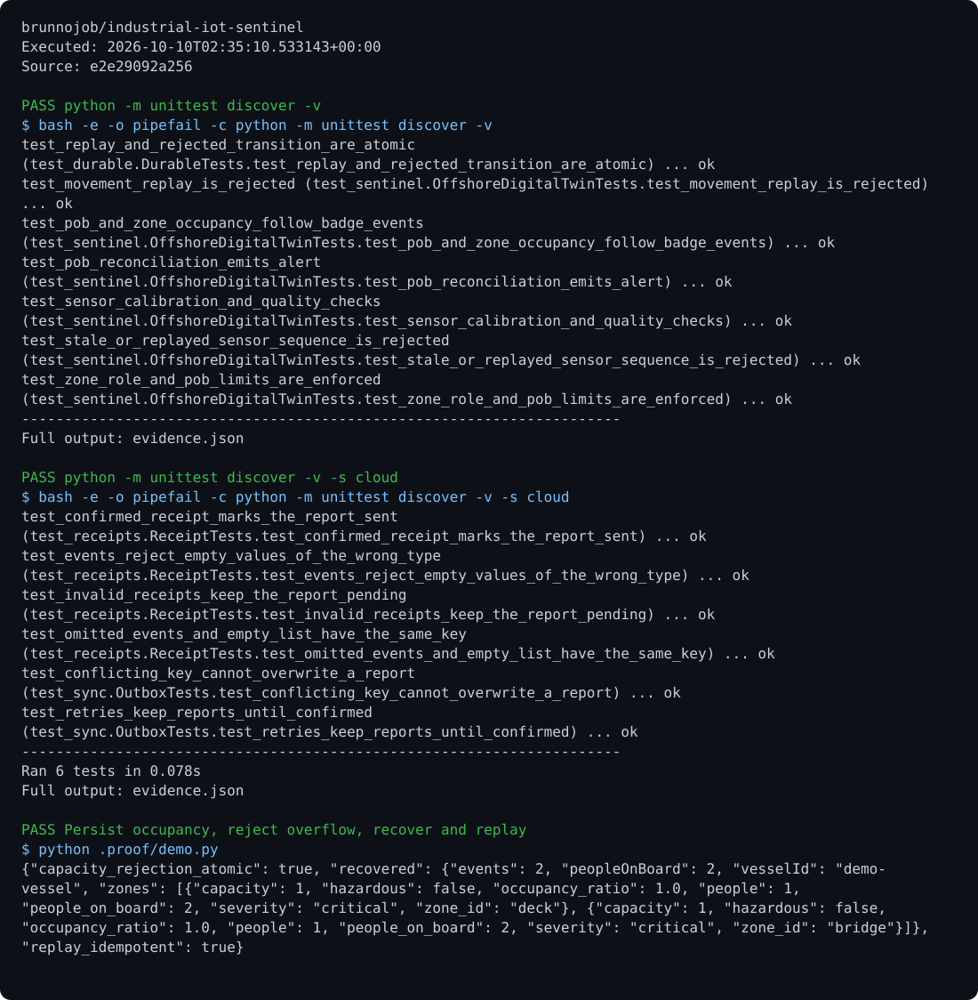

# Industrial IoT Sentinel

[View execution evidence](https://brunnojob.github.io/devstart-lab/proofs/industrial-iot-sentinel/)

An operational vessel occupancy twin with zone capacity, personnel roles, and idempotent movements recovered from a SQLite journal.

## Run

Requirements: Python 3.11+.

```sh
python -m unittest discover
python -m unittest discover -s cloud
python events.py examples/vessel.json --database .local/twin.db < examples/movements.jsonl > result.json
```

## Behavior

`DurableTwin` refreshes its occupancy from the append-only SQLite journal inside each transaction. Separate instances opening the same database observe committed movements before enforcing capacity. Failed transitions preserve the prior state. A configuration fingerprint prevents silent changes to vessel policies in an existing database.

`submit_many` accepts 1 to 1000 events and commits the entire batch together. Replaying an identifier with an equivalent event returns a duplicate result; changing that event is rejected. Movement timestamps must be finite, nonnegative and nondecreasing for each person. Use the context manager or `close()` to release a journal connection.

The journal is append-only. Do not edit or delete stored movements or share the database across machines through a network filesystem. Read occupancy through `snapshot()`; direct access to `twin` reflects only the last state loaded by that instance.

## JSONL processing

```sh
python events.py examples/vessel.json --database .local/twin.db --atomic-batch --ack-jsonl < examples/movements.jsonl
```

By default, each input event commits separately and the final snapshot is written to stdout. On a later failure, earlier events remain committed. `--atomic-batch` buffers up to 1000 movements, validates all of them and commits them together. `--ack-jsonl` emits movement acknowledgements after commit, followed by a snapshot envelope. Replaying the example file is safe.

Errors go to stderr with exit status 2. Parse failures identify the input line. Input records are limited to 8192 UTF-8 bytes, duplicate JSON fields are rejected, and configuration files are limited to 1 MiB. The accepted fields are `eventId`, `personId`, `direction`, `timestamp` and optional `zoneId`. `zoneId` is required when embarking; disembarking without a zone finds the person's current location. The example roster is fictional test data.

## Telemetry integrity

`SensorService` validates calibrated ranges, quality, freshness, ordered sequence numbers and nondecreasing timestamps per sensor. Scaling handles extreme finite endpoints without overflowing intermediate arithmetic. Concurrent duplicate readings cannot advance sensor state twice. `diagnostics()` returns an independent snapshot with the latest sequence, timestamp and missing-sequence count. Sequence numbers do not reset automatically on device restart; explicitly establish a new service/session when a device's sequence resets.

## Optional report archive

Export a JSON report from the command above, then run `python cloud/sync.py enqueue result.json --project industrial-iot-sentinel` and `python cloud/sync.py sync`. Synchronization requires `BRUNNODEV_ACCESS_TOKEN` and the external operations API; the local outbox retains unacknowledged reports.

## License

Original source and documentation are MIT licensed; see [LICENSE](LICENSE). Third-party dependencies and media retain their respective terms. Maintained by [Brunno Dev](https://brunnodev.store).

## Implementation update

Sensor specifications require finite calibration endpoints and unique sensor identifiers. Readings reject invalid clocks, timestamps, non-finite values and invalid sequence numbers before advancing sensor state.

Contributors: [brunnojob](https://github.com/brunnojob) and [ineedfoundmyway](https://github.com/ineedfoundmyway).

Current improvements use the requested trailer: `Co-authored-by: notalkolitc <335617c1+notalkolitc@users.noreply.github.com>`.

## Execution proof

[](https://github.com/brunnojob/industrial-iot-sentinel/actions/workflows/proof.yml)



[Verified run](https://github.com/brunnojob/industrial-iot-sentinel/actions/runs/38017991930) · [Execution report](docs/proof/evidence.json)

Run `python .proof/record.py` after installing the prerequisites above. The scenarios execute repository code and verify exit codes and expected output. CI publishes `execution-proof` with the transcript, input fingerprints and source commit. The downloadable report identifies the exact tested version; the workflow badge tracks the latest run.


CI verifies Python 3.11, 3.12 and 3.13. The executable proof includes the documented JSONL command, recovery scenario, full unit suite and cloud outbox suite, with source and input fingerprints.
